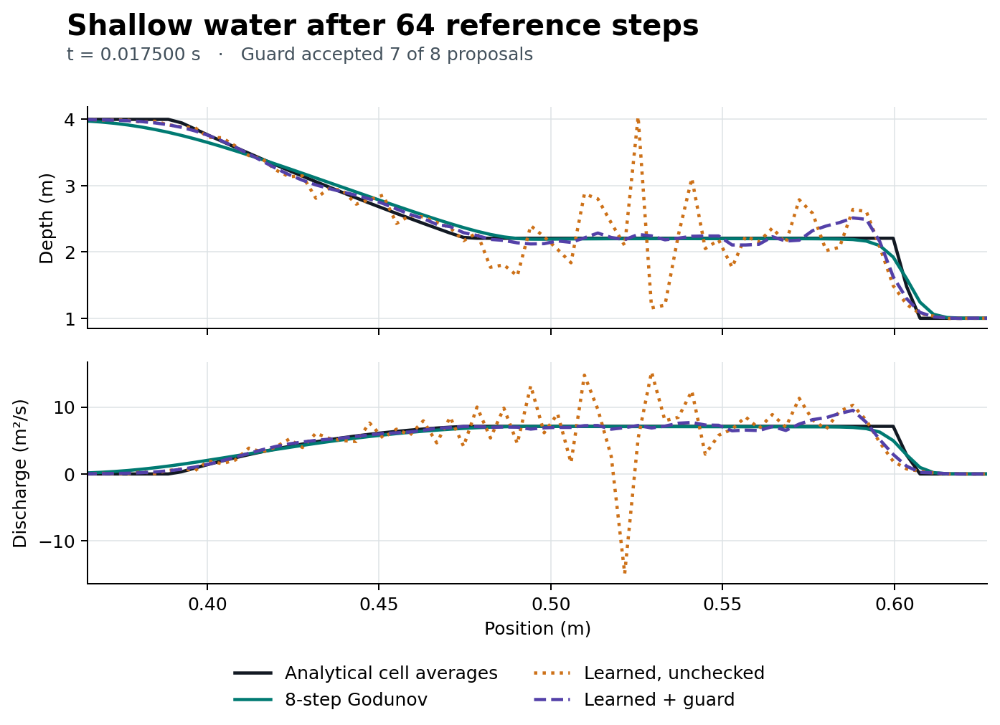
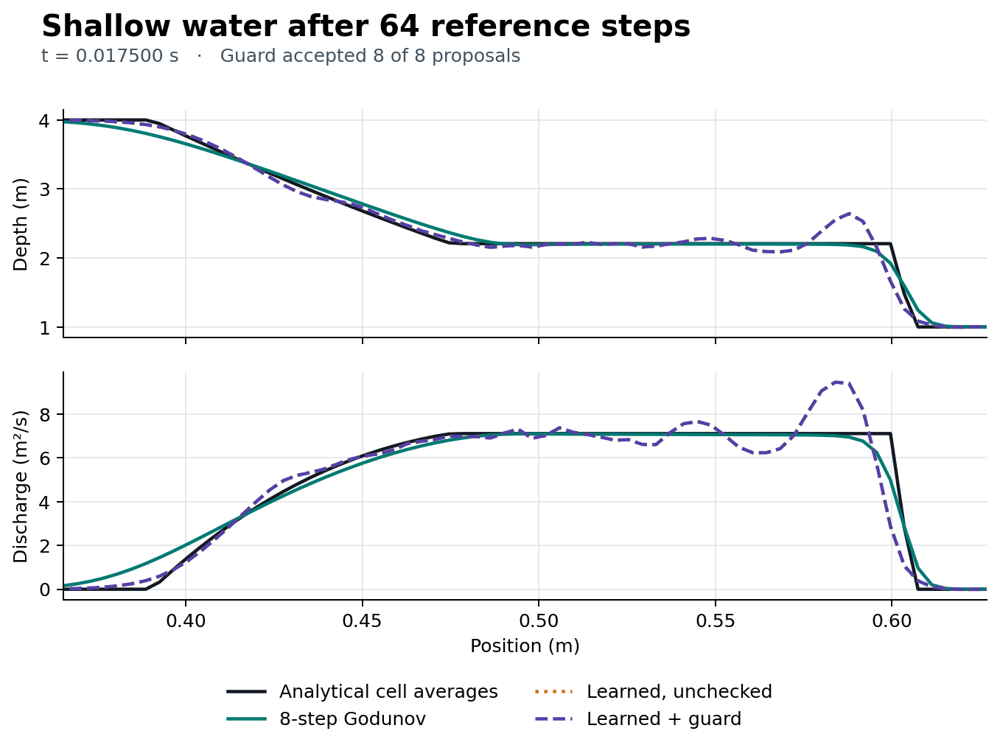

# 천수방정식 8스텝을 한 번에 예측하는 보존형 신경망

256셀의 현재 수심 (h)와 단위 폭당 유량 (hu)로부터 8스텝 뒤 두 변수의 유동장 전체를 예측한다. 채택한 블록에서는 리만 문제를 풀지 않는다. 거절하면 원래 입력에서 Godunov 8스텝을 실행한다. 검증·재계산을 포함한 단일 코어 시간은 통상적인 Godunov 8스텝보다 짧았다. 해석해·고해상도 기준해에 대한 두 변수의 오차까지 맞춘 비교에서는 고전 근사 솔버가 앞섰다.

## 선행연구에서 가져온 설계

- Keppler 등은 2차원 댐 붕괴에서 초기 유동장으로 여러 시각의 해를 학습했고 급격한 파면이 매끄러워지는 현상을 보고했다. 여기서는 고정된 1차원 격자를 사용하고 수심·유량과 충격파 위치를 각각 평가했다. [Water Resources Research](https://doi.org/10.1029/2025WR042156)
- Chen·Gelb·Lee는 1차원 천수방정식을 포함한 쌍곡형 보존법칙에서 인접 셀이 공유하는 flux를 학습했다. 여기서는 한 블록의 **시간평균 flux**를 추정해서 각 셀의 양 끝 flux 차이로 끝상태를 계산한다. [Designing Neural Networks for Hyperbolic Conservation Laws](https://arxiv.org/abs/2211.14375)
- Brandstetter·Worrall·Welling은 여러 미래 시각을 한 호출에서 출력하는 temporal bundling을 연구했다. 여기서는 목표를 **8번째 끝상태 하나**로 좁혔다. 이 실험의 연구 질문은 호출을 생략한 시간, 검증 비용, 허용오차를 넘긴 채택 수의 관계다. [ICLR 2022](https://openreview.net/forum?id=vSix3HPYKSU)

## 모델과 기준 데이터

실험 범위는 길이 1 m, 평평한 바닥, 양의 수심, 열린 양 끝 경계, 중력 9.81 m/s²이다. 고정된 기준 스텝의 Δt/Δx는 0.07 s/m로 한 블록의 물리 시간은 0.0021875 s이다. 신경망은 각 경계의 수심·유속과 상태 차이에서 얻은 여섯 특징을 여덟 ReLU 유닛으로 변환한다. 공간 합성곱은 인접한 15개 경계의 정보를 모아 flux를 예측한다. 596개 학습 파라미터는 모든 위치에서 공유한다. 인접한 두 셀이 같은 flux를 사용하므로 내부 경계를 통과한 질량과 운동량은 서로 상쇄된다. 양 끝의 flux는 경계 셀의 물리 flux로 둔다. [학습](../../shallow_water/macro8_model.py) · [C 추론](../../shallow_water/macro8_predict.c)

입력 유형은 부드러운 파동, 위치와 방향이 다른 댐 붕괴, 서로 접근하는 파동, 고전 솔버로 이미 진화시킨 유동장이다. 학습 256개, 추가 학습 후보 256개, 개발 96개, 검증기 임계값 보정 256개는 서로 독립적으로 생성했다. 초기 모델에 같은 학습량을 추가한 두 대조 모델을 만들었다. 하나는 무작위 64개 궤적을 쓰고, 다른 하나는 후보 중 상대오차가 큰 32개를 먼저 고른 후 나머지 32개를 무작위로 뽑았다. 후보 256개 모두 최초의 평균오차 허용 기준을 만족했다. 따라서 이 첫 비교가 측정하는 것은 **실패가 없어도 큰 오차를 우선해 학습하는 효과**다. 일반 평가 128개와 수심 차·유속·파동의 공간 주파수 범위를 변경한 평가 128개를 따로 생성했다. [데이터 생성](../../shallow_water/macro8_data.py) · [모델별 학습 기록](training.json)

## 검증기가 확인하는 것

1. 출력이 유한하고 모든 수심이 양수인지 확인한다.
2. 양 끝의 유입·유출량을 반영하여 전체 질량과 운동량의 수지를 검사한다. 입력 양 끝에 일정한 셀이 각각 여덟 개 이상 있어야 경계 flux의 시간 이력을 알 수 있으므로, 이 조건을 충족하지 못하면 Godunov로 돌아간다.
3. 두 셀 간격의 작은 구간마다 블록 시작·종료 시점으로부터 근사한 flux와 실제 예측 변화의 차이를 구한다. 보정 데이터에서 이 점수가 낮을 때 실제 끝상태 오차도 작았던 범위까지 채택한다.

기본 허용 기준은 **개별 유동장에서 256셀 평균 절대오차가 수심 0.01 m, 유량 0.04 m²/s 이하**인 것이다. 비교 대상은 같은 입력으로 계산한 같은 격자의 Godunov 8스텝이다. 이 검증은 경험적이다. 양의 수심과 보존을 만족하며 국소 잔차가 거의 0인 인공 예측도 수심 평균오차 0.0208 m를 낼 수 있음을 테스트로 확인했다. 기존 경계 중간 수심 실험의 수학적 보장은 그 경계 문제에만 적용된다. [C 검증·fallback](../../shallow_water/macro8_guard.c) · [보정값](guard.json) · [반례 테스트](../../tests/shallow_water/test_macro8_guard.py)

## 한 블록의 정확도와 속도

AMD EPYC 9V74의 한 코어, FP64, 최적화한 C 커널로 측정했다. 각 수치는 128개 유동장을 순차 처리한 시간을 개수로 나눈 값의 13회 중앙값이다. 모델 호출, 검증, 할당, 거절 후 8스텝 재계산이 해당 방법의 시간에 들어간다. 엄격한 중간 수심 검사를 쓰는 Godunov와 보통의 Newton 종료 기준을 쓰는 Godunov를 모두 측정했다. 시간 스텝을 CFL에 맞게 더 크게 잡는 고전 방법도 동일한 물리 시각에서 비교했다.

| 한 유동장당 시간 또는 건수 | 일반 입력 | 분포를 바꾼 입력 |
| --- | ---: | ---: |
| 보통의 Newton을 쓰는 Godunov 8스텝 | 40.69 µs | 43.97 µs |
| 큰 오차를 우선 학습한 신경망 한 번 | 5.86 µs | 6.21 µs |
| 같은 신경망 + 검증 + fallback | 6.78 µs | 10.26 µs |
| 채택 / 전체 | 128 / 128 | 109 / 128 |
| 기준을 초과한 채택 / 채택 | 0 / 128 | 8 / 109 |
| 최종 결과가 기준을 통과한 수 | 128 / 128 | 120 / 128 |
| 현재 유동장을 그대로 반환해도 기준을 통과하는 수 | 35 / 128 | 7 / 128 |

별도로 댐 붕괴는 해석적 셀 평균, 나머지는 동일한 초기 셀 평균을 4배 세밀한 격자에 복사해 진행한 뒤 다시 평균한 Godunov 해와 비교했다. 각 입력 집합에서 수심과 유량 양쪽의 평균 절대오차가 모두 엄격한 Godunov의 1.05배 이하여야 동등 정확도 후보로 인정했다. 그 조건을 만족한 가장 빠른 방법은 일반 입력의 Rusanov(6.03 µs), 분포 변경 입력의 HLLE(9.40 µs)였다. 검증형 신경망의 유량 오차는 각각 0.00962, 0.02357 m²/s로 목표 0.00843, 0.01547 m²/s를 넘었다. 이 비교에서 신경망은 동등 정확도 가속을 달성하지 못했다. 한 블록의 댐 붕괴에서 신경망+검증의 평균 충격파 위치 오차는 각각 0.098셀, 0.214셀이었다. [방법별 시간·수심·유량·파면 오차](benchmark.json)

기본 허용오차에서 학습·보정 사례들이 모두 통과한 것을 보고, 보조 실험에는 각각 10배 더 엄격한 기준(0.001 m 및 0.004 m²/s)을 정했다. 같은 가중치로 보정 데이터에서만 점수 임계값을 다시 골랐다. 일반 입력에서 38/128개를 채택했고 모두 허용 범위였다. 변경된 분포에서는 5/128개를 채택했고 1개가 두 오차 기준을 넘었다. 일반 입력의 검증형 시간은 27.60 µs, 변경된 분포에서는 65.43 µs였다. 같은 측정에서 일반적인 8스텝에 비해 속도를 절약하는지는 입력 분포와 허용오차에 따라 달라졌다. [더 엄격한 기준](strict.json)

## 64스텝 연속 실행

평가 집합별 48개 유동장을 8블록 동안 이어서 풀었다. 각 방법은 직전 블록에서 자신이 계산한 값을 다음 입력으로 사용했다. 최종 오차는 처음 주어진 유동장에서 출발한 기준 궤적과 비교했다. 각 채택의 국소 오차는 해당 시점에 검증기에 들어온 유동장에서 기준 솔버를 다시 실행해 따로 측정했다. 이 사후 검사는 실행시간에 들어가지 않는다.

| 8블록 결과 | 일반 입력 | 분포를 바꾼 입력 |
| --- | ---: | ---: |
| 검증 없는 신경망으로 양의 수심을 유지한 궤적 | 48 / 48 | 33 / 48 |
| 검증과 fallback으로 완주한 궤적 | 48 / 48 | 48 / 48 |
| 기준을 넘긴 채택 / 전체 채택 | 24 / 315 | 64 / 263 |
| 검증형 끝상태 수심 평균오차, 4배 격자 기준 | 0.00713 m | 0.01135 m |
| 검증형 끝상태 유량 평균오차, 4배 격자 기준 | 0.03745 m²/s | 0.06352 m²/s |

관측한 15건의 음수 수심 실패를 검증과 fallback으로 모두 막았다. 일반 입력에서도 한 블록 평가 때 관찰되지 않았던 허용오차 초과가 반복 예측 도중에 나타났다. 한 하드웨어와 하나의 초기 학습 시드에서 측정한 결과이며 이 장기 실험의 48개씩은 한 블록 평가 집합의 부분집합이다. [블록별 결과](trajectory.json)

8블록을 연속으로 처리한 실제 시간은 검증형 신경망이 일반·변경 분포에서 각각 360.07·444.26 µs였다. 같은 궤적에서 보통의 Newton과 CFL에 맞춘 Godunov는 217.23·267.31 µs, CFL에 맞춘 HLLE는 71.14·86.25 µs였다. 한 블록에서 얻은 가속 배수를 긴 궤적에 적용하면 이 차이를 놓치게 된다. [64스텝 전체 시간](trajectory_timing.json)



## 신경망이 계산한 중간 상태를 이용한 재학습

첫 실험에서 예상하지 못한 오차가 모델을 여러 번 이어 쓸 때 나타났다. 후속 실험에서는 학습 전용 초기장 128개에서 출발해 첫 모델을 최대 8블록 실행하고, 매번 **모델 자신이 도달한 상태**에서 고전 솔버를 8스텝 실행해 다음 블록의 정답을 만들었다. 정답을 얻은 중간 상태 1,023개 중 103개는 실제로 첫 모델의 기본 허용오차를 넘었다. 중간 상태 하나는 기준 솔버의 CFL 조건을 위반해 정답을 만들 수 없었다. 두 모델 모두 첫 모델과 동일한 가중치에서 출발해 96개 상태, 같은 횟수로 학습했다. 무작위 추출은 실제 실패 6개, 어려운 상태 우선 추출은 실제 실패 55개를 포함했다.

가중치를 고정한 후 앞선 평가에서 쓰지 않은 ID 256–287을 각 분포에서 시험했다. 검증기를 붙이지 않고 64스텝을 진행했을 때, 끝상태의 수심·유량이 모두 같은 격자의 Godunov 궤적과 기본 허용오차 이내였던 수를 아래에 표시한다. 음수 수심으로 중단한 경우도 분모에 포함했다.

| 기본 허용오차 이내 / 32개 궤적 | 재학습 전 | 중간 상태 무작위 재학습 | 어려운 중간 상태 우선 재학습 |
| --- | ---: | ---: | ---: |
| 일반 입력 | 18 | 32 | 32 |
| 분포 변경 입력 | 4 | 15 | 15 |
| 분포 변경 입력에서 양의 수심으로 완주 | 23 | 30 | 27 |

이 비교에서 개선을 설명하는 요인은 실제 실행 중 방문하는 상태를 학습에 포함한 것이다. 어려운 상태를 따로 고르는 정책이 무작위 재학습보다 일관되게 더 우수하다는 증거는 얻지 못했다. [재학습 결과와 실패 기록](replay.json) · [실험 코드](../../shallow_water/macro8_rollout_replay.py)

## 재학습한 모델의 최종 확인

실제 사용 기본값은 방문 상태를 무작위로 재학습한 모델과 검증기다. 이 모델을 먼저 정하고, 학습·모델 선택에 사용하지 않은 새 유동장(ID 320–383, 각 분포 64개)에서 확인했다. 임계값은 독립 보정 집합만 사용해 가중치별로 다시 정했다. 첫 모델, 무작위 재학습, 어려운 상태 우선 재학습의 추론 구조와 C 코드가 같으며, 가중치만 교체한다.

| 8스텝 구간 한 번, 기본 재학습 모델 | 일반 입력 | 분포 변경 입력 |
| --- | ---: | ---: |
| 보통의 Newton을 쓰는 Godunov 8스텝 | 44.77 µs | 46.21 µs |
| 신경망 + 검증 + fallback | 6.95 µs | 9.38 µs |
| 채택 / 재계산 | 64 / 0 | 57 / 7 |
| 기준을 넘긴 채택 / 전체 채택 | 0 / 64 | 2 / 57 |
| 독립 기준해와의 동등 정확도를 만족한 최단 시간 | 6.21 µs, Rusanov | 10.00 µs, HLLE |

분포 변경 입력에서 신경망은 HLLE보다 시간이 짧았지만 독립 기준해 대비 평균 유량 오차가 0.02066 m²/s로 목표 0.01338 m²/s를 넘었다. 일반 입력에서도 유량 오차가 0.00945 m²/s로 목표 0.00880 m²/s를 넘었다. 1차 Godunov의 동작을 빠르게 모사하는 성능과 PDE 해를 같은 정확도로 빠르게 구하는 성능을 구분할 수 있는 결과다. [최종 단일 블록 평가](replay_evaluation.json) · [고정한 검증 임계값](replay_guard.json)

같은 새 유동장 중 각 32개(ID 320–351)를 연속 8블록 계산하고, 매 블록의 입력 상태에서 별도로 정답을 계산해 잘못된 채택을 집계했다. 표의 비율은 **허용오차 초과 채택 / 전체 채택**이다. 64스텝 시간에는 거절 후 재계산을 포함했다.

| 64스텝 방법 | 일반 입력의 잘못된 채택 | 분포 변경 입력의 잘못된 채택 | 분포 변경 입력의 시간 | 끝상태 수심·유량 MAE, 4배 격자 기준 |
| --- | ---: | ---: | ---: | --- |
| 첫 모델 + 검증 | 22 / 208 | 39 / 181 | 443.1 µs | 0.01167 m, 0.06483 m²/s |
| 방문 상태 무작위 재학습 + 검증 | 0 / 213 | 19 / 203 | 382.3 µs | 0.01006 m, 0.05076 m²/s |
| 어려운 방문 상태 우선 재학습 + 검증 | 0 / 214 | 12 / 205 | 393.2 µs | 0.01048 m, 0.04836 m²/s |
| CFL에 맞춘 HLLE | 해당 없음 | 해당 없음 | 89.6 µs | 0.00580 m, 0.02268 m²/s |

검증형 모델 세 가지 모두 64개 궤적을 끝까지 계산했다. 분포를 바꾼 이 확인 집합에서 어려운 상태를 우선한 방법은 잘못된 채택 비율이 가장 낮았고, 무작위 재학습은 신경망 방법 중 가장 빨랐다. 속도와 정확도 양쪽에서 HLLE가 앞섰다. 표의 케이스 수는 확률적 보증이 아니며 각 궤적 안의 채택들은 서로 의존한다. [최종 64스텝 평가](replay_trajectory.json)



## 실행

저장소 루트에서 Python 3.12, NumPy, GCC가 필요하다. 그림 생성에만 Matplotlib을 사용한다. 첫 명령은 저장된 가중치와 임계값으로 실행한다. 입력을 주지 않으면 왼쪽 4 m, 오른쪽 1 m이고 물이 정지한 댐 붕괴로 시작한다.

```bash
python -m shallow_water.macro8 --blocks 1
python -m shallow_water.macro8 --blocks 8 --plot dam_break_retrained.png
python -m shallow_water.macro8 --weights offline-hard --blocks 8 --plot dam_break.png
python -m shallow_water.macro8 --input state.npy --blocks 8 --out predicted.npy
python -m unittest discover -s tests/shallow_water -v
```

사용자 입력은 256행, 2열의 수치 배열이고 열 순서는 수심(m), 단위 폭당 유량(m²/s)이다. `--method neural`로 검증 없이 실행할 수 있고, `--method hlle`로 같은 시간까지 고전 방법을 실행할 수 있다. 명령행 프로그램은 실행 시 네이티브 코드를 컴파일한다. 위 실행시간은 이미 빌드된 커널을 사용한 시간이며 Python 시작, 컴파일, 학습, 사후 정답 계산을 제외한다. 프로그램에서 여러 유동장을 처리할 때는 `build_replay_native`로 한 번 로드한 라이브러리를 재사용할 수 있다. [실행 인터페이스](../../shallow_water/macro8.py) · [배포용 가중치 로더](../../shallow_water/macro8_replay_native.py)

학습부터 재현하려면 아래 순서를 사용한다. 각 명령은 해당 실험의 결과를 다시 쓴다.

```bash
export OPENBLAS_NUM_THREADS=1 OMP_NUM_THREADS=1
python -m shallow_water.macro8_model
python -m shallow_water.macro8_guard
python -m shallow_water.macro8_benchmark
python -m shallow_water.macro8_strict
python -m shallow_water.macro8_trajectory
python -m shallow_water.macro8_trajectory_timing
python -m shallow_water.macro8_rollout_replay
python -m shallow_water.macro8_replay_evaluation
python -m shallow_water.macro8_replay_trajectory
```
