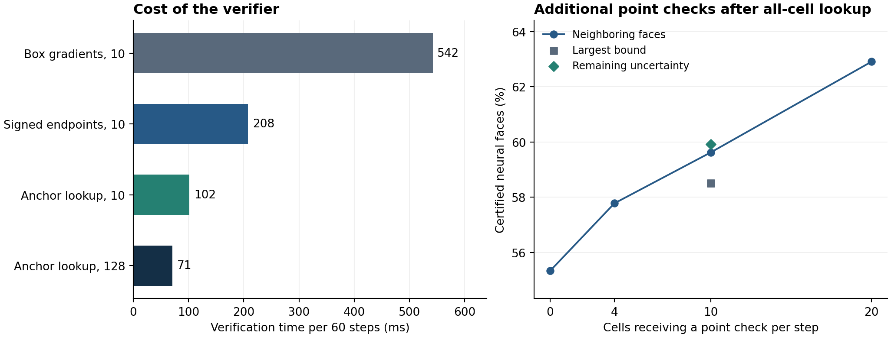

# 검증 예산을 어디에 쓸 것인가

주어진 누적 오차 허용량 안에서 신경망 flux를 인증할 수 있는 면의 비율을 높이는 문제를 다룬다. 각 스텝에서 검사 위치를 정하는 정책은 현재 상태와 저렴한 인증 결과를 볼 수 있다. 정밀 검사 후 기존 A2 동적 계획법이 각 면에 신경망 또는 Godunov flux를 배정한다. 기준해는 동일한 격자의 정확 산술 Godunov 궤적이다.

오차 허용량, 검증 계산량, 인증 채택률은 서로 다른 양이다.

- **오차 예산**은 기준 궤적과의 공간 평균 절대 오차에 허용한 누적 상한이다. 모든 방법에 초기조건별로 같은 값을 부여했다.
- **검사 예산**은 스텝당 정밀 검사할 수 있는 셀 수다. 셀 하나가 양쪽 면을 사용하므로 참조 flux의 점별 구간을 구한 고유 면 수도 기록했다. 배치로 계산하므로 검사 횟수와 실행 시간은 따로 측정했다.
- **채택률**은 60스텝 동안 전체 7,680개 면 결정 중 라우터가 신경망 flux를 선택한 비율이다. 실제 해의 정확도 향상이나 전체 솔버의 가속을 뜻하는 지표로 사용하지 않는다.

## 검증기의 변경

기존의 local 검사는 검사할 면에서 신경망 flux와 정확 Godunov flux의 차이를 구간으로 계산하고 그 절댓값 상한을 취한다. 셀의 양쪽 면 모두에 신경망을 쓰는 경우에는 오차의 부호에 따른 상쇄가 중요하다. 기존 방식은 두 입력을 포함하는 직사각형에서 네트워크 출력과 두 편미분의 구간을 전파해서 두 오차의 차이를 제한한다. ReLU의 활성 여부가 불확실할 때는 기울기 구간에 0과 1을 모두 포함한다. 각 활성 패턴을 개별적으로 열거하지는 않는다.

**부호 있는 끝점 검사**는 현재 면에서 FP64 네트워크 출력과 정확 Godunov flux의 차이인 \(e_f\)를 포함하는 구간 \(I_f=[l_f,u_f]\)를 보존한다. 셀의 왼쪽과 오른쪽 면이 모두 신경망이면 필요한 것은 두 입력에서의 오차 차이다. 그 범위는 \([l_R-u_L, u_R-l_L]\)이고, 바깥쪽 반올림 후 양 끝 절댓값의 최댓값이 인증 상한이다. 두 면 사이에서 기울기를 계산할 필요가 없다. 기존 상한과 새 상한 중 더 작은 것을 쓰고, 혼합 패턴에서는 Godunov 부동소수점 오차를 유지한다. 점별 방식은 검사한 면에서 Godunov 식도 구간으로 계산한다.

**결정적 FP64 출력 미리 계산**은 점별 검사의 변형이다. 이 코드의 동결된 네트워크는 배치에 있는 다른 행에 관계없이 같은 면 입력에 같은 비트의 출력을 낸다. 인증 대상인 실제 출력을 미리 계산해 폭 0인 구간으로 쓰면 뉴런별 출력 구간 전파도 생략할 수 있다. 검사 후 해당 면을 채택할지는 아직 결정되지 않았으므로 예측 선실행과 Godunov 점별 구간 계산이 모두 비용에 포함된다. 다른 추론 커널로 바꾸면 비트 단위 동일성을 다시 확보해야 한다.

**중심점 기반 표(anchor)**는 두 입력축을 각각 128개 구간으로 나눈다. 각 구간 쌍에서 중심점의 부호 있는 오차와 그 구간 안의 기울기 범위를 오프라인으로 인증한다. 실제 입력에서 중심점까지의 거리와 저장된 기울기 범위를 사용해 해당 면의 부호 있는 오차 구간을 얻는다. 이 계산은 신경망의 부동소수점 평가 오차와 구간 산술의 반올림을 포함한다. 온라인 검증 중에는 신경망 실행, Godunov 식의 점별 평가, 구간 미분이 모두 필요 없다. 실제 시간 스텝의 flux 업데이트는 인증 후 정상적으로 수행한다. 표는 동결된 모델과 입력 범위에 종속된다.

**2단계 검사**에서는 전체 셀에 중심점 표를 먼저 적용한다. 그런 다음 일부 셀에만 부호 있는 끝점 검사를 수행한다. 검사 위치가 달라져도 최종 라우터의 예산에는 계산된 인증 상한만 들어간다. 할당 규칙은 세 가지를 비교했다.

1. 양쪽 면에 신경망을 쓸 때 현재 상한이 가장 큰 셀을 고른다.
2. 이웃한 면을 함께 쓸 후보 구간들을 검토하고, 예산 안에서 긴 구간이 가능해질 것으로 예상되는 위치를 고른다. 후보를 평가할 때 정밀 검사 후 비용이 0까지 떨어질 수 있다고 가정한다.
3. 같은 후보 구간에 대해 현재 상한에서 **실제로 줄어들 여지**를 추정한다. 예를 들어 부호 있는 오차가 [0.90, 0.91]이면 실제 크기가 적어도 0.90이므로 큰 상한을 크게 줄이기 어렵다. 두 면의 부호 있는 오차 구간 사이의 최소 거리도 같은 용도로 사용한다. 이 구현에서는 선택기가 표를 한 번 더 조회하는 시간까지 반영했다.

앞선 BAMG식 재학습 비교는 [기존 실험](../selective_refinement/README.md)에 있다. 이번 실험은 flux 신경망을 고정하고, 인증 방식과 검사 위치 결정의 효과를 비교한다.

## 실험 결과

### 기존 검증기에서 어떤 계산을 줄일 수 있는가

9개 초기 상태에서 기존 상한이 큰 10개 셀을 고르고 같은 입력에서 두 수치 커널을 7회씩 측정했다. 10개 셀에 연결된 고유 면은 12~18개였다. 점별 오차 구간은 평균 1.76 ms, 셀별 구간 미분을 포함한 차이 상한은 평균 5.47 ms였다. 이는 두 커널의 시간이며 셀 선택이나 최종 라우팅 비용을 포함하지 않는다.

아래는 1차 세트에서 60스텝을 실행한 결과다. 셀 10개를 고르는 행들은 모두 같은 이웃 면 규칙을 쓴다. 검증 시간은 라우팅과 상태 업데이트를 제외한다.

| 방법 | 채택률 | 검증 시간 | 전체 시간 |
|---|---:|---:|---:|
| 기본 표만 사용 | 1.72% | 0.037초 | 0.274초 |
| 기존 local 전체 128셀 | 68.27% | 0.873초 | 1.134초 |
| 기존 local 10셀 | 33.30% | 0.542초 | 0.791초 |
| 부호 있는 끝점 10셀 | 33.82% | 0.208초 | 0.461초 |
| 결정적 FP64 출력 미리 계산 10셀 | 33.80% | 0.107초 | 0.360초 |
| 중심점 표 10셀 | 31.89% | 0.102초 | 0.348초 |
| 중심점 표 전체 128셀 | 59.81% | 0.071초 | 0.322초 |
| 부호 있는 끝점 전체 128셀 | 78.95% | 0.263초 | 0.516초 |

같은 10셀 규칙에서 부호 있는 끝점 방식은 기존 local의 검증 시간을 61.7% 줄였다. 전체 중심점 표 조회는 10셀만 골라 조회하는 것보다 빠르고 채택률도 높았다. 표 조회를 벡터화할 수 있고 전체 조회에서는 후보 구간을 탐색하지 않는다. 기본 표에 추가한 중심점 표는 788,488바이트이고 생성에 0.96초가 들었다. 이 시간은 60스텝 측정에서 제외했다.

검사 위치 자체의 효과를 보기 위해 9개의 시작 상태를 고정하고 같은 첫 스텝 예산에서 가능한 10셀 조합을 사후 동적 계획법으로 평가했다. 첫 스텝 평균 채택률은 단순 상위 선택 36.20%, 이웃 면 규칙 39.93%, 모든 검사 결과를 미리 아는 최적 위치 선택 43.14%, 전체 중심점 표 62.33%였다.

### 전체 표 조회 후 추가 정밀 검사를 어디에 쓸 것인가

새 초기조건 9개에서 독립적으로 확인했다. 아래의 ‘미조회 채택률’은 해당 스텝에서 Godunov 식의 점별 구간을 계산하지 않고 신경망을 채택한 면이 전체 면 결정에서 차지하는 비율이다. ‘고유 면’은 점별 구간을 실제로 조회한 면 수의 스텝당 평균이다. 전체 표 조회는 고유 면 수에 포함하지 않는다.

| 방법 | 추가 정밀 검사 셀 | 점별 검사 고유 면 | 전체 채택률 | 미조회 채택률 | 검증 시간 | 전체 시간 |
|---|---:|---:|---:|---:|---:|---:|
| 전체 중심점 표 | 0 | 0.00 | 55.33% | 55.33% | 0.060초 | 0.275초 |
| 이웃 면 | 4 | 6.81 | 57.78% | 55.37% | 0.195초 | 0.419초 |
| 상한이 큰 순서 | 10 | 16.43 | 58.51% | 55.45% | 0.178초 | 0.398초 |
| 이웃 면 | 10 | 14.73 | 59.62% | 53.96% | 0.195초 | 0.411초 |
| 줄일 여지를 고려한 이웃 면 | 10 | 13.95 | 59.92% | 52.29% | 0.218초 | 0.437초 |
| 이웃 면 | 20 | 26.17 | 62.91% | 51.49% | 0.200초 | 0.418초 |
| 전체 점별 검사 단독 | 128 | 128.00 | 79.93% | 0.00% | 0.237초 | 0.460초 |

같은 10개 셀 예산에서 전체 채택률은 58.51~59.92%였다. 줄일 여지를 고려한 규칙이 이웃 면 규칙보다 평균 0.30%p 높았고 추가 계산 시간이 들었다. 이 차이는 초기조건별로 −4.39~+2.64%p였다. 20개를 검사하는 이웃 면 규칙은 이 설정에서 10개 불확실성 규칙보다 검증 시간이 짧고 전체 채택률이 높았지만, 점별 참조를 조회한 면 수는 약 26개 대 14개였다.

전체 표 조회 대비 10개 불확실성 검사는 전체 채택률을 4.59%p 올렸다. 같은 스텝에서 점별 참조값을 확인하지 않고 채택한 비율은 55.33%에서 52.29%로 내려갔다. 따라서 정밀 검사에 부여하는 가치가 전체 인증 채택인지, 참조를 조회하지 않은 채택인지에 따라 정책의 순위가 달라진다.



서로 다른 정책·초기조건 조합 252개 전부 누적 예산 이내였다. 따로 재실행한 15개 궤적, 총 900스텝에서 정확 유리수 한 스텝 오차 검사와 누적 검사를 모두 통과했다. 누적 검사는 부동소수점 Godunov 기준 궤적의 반올림 허용량도 포함한다. 이 검사는 명시한 산술 가정을 바탕으로 한 증명의 구현을 점검한다.

## 설계와 해석 범위

- 격자 셀 128개, 주기 경계, 60스텝, 시간 간격 대 격자 간격 비율 0.2를 고정했다. 동결 flux, 기본 16분할 표, pacing 정책은 모든 실험에서 동일하다.
- 1차 실험은 이전 비교에서 사용한 초기조건 9개를 재사용했다(seed 9702). 2차 실험은 새 초기조건 9개를 생성했다(seed 241124). 각 세트는 매끄러운 파형, 충격이 발달한 파형, 구간별 상수 Riemann 초기조건을 3개씩 포함한다. 격자나 PDE가 달라질 때의 성능은 별도 문제다.
- 각 초기조건에서 전체 신경망·전체 local로 보정한 누적 인증 비용의 30%를 모든 정책에 공통으로 주었다. 30%는 방법을 비교하기 위한 실험 설정이다. 실제 사용자가 지정하는 허용 오차가 이미 있으면 보정용 기준 궤적은 필요 없다.
- 한 CPU 스레드에서 워밍업 후 초기조건마다 순서를 무작위로 바꿔 2회 측정했다. 시간은 초기조건별 중앙값의 평균이다. 검증 시간에는 셀 선택과 실제 상한 계산이 모두 들어간다. 전체 시간은 여기에 라우팅, 업데이트, 예산 회계를 포함한다. 표 생성, 예산 보정, 사후 검산은 별도다. 작은 시간 차이는 이 환경에 의존한다.
- 최종 채택률은 정책별로 달라진 궤적을 60스텝 따라간 결과다. 첫 스텝의 동일 상태를 고정하고 모든 검사 결과를 본 뒤 최상의 위치를 고르는 별도 진단도 수행했다. 이 수치는 60스텝 전체의 최적성을 보장하지 않는다.

## 재현

저장소 루트에서 Stage AB 의존성을 설치하고 다음 명령을 실행한다.

```bash
export OMP_NUM_THREADS=1 OPENBLAS_NUM_THREADS=1 MKL_NUM_THREADS=1
python -m stage_ab.profile_local_checks --out outputs/allocation/profile.json
python -m stage_ab.experiments_verifier_allocation --splits fresh --counts 4 10 20 --repeats 2 --out outputs/allocation/evaluation.json
python -m stage_ab.experiments_verifier_allocation --splits confirmation --only-methods selective_anchor/all/128 anchor_then_point/top/10 anchor_then_point/block/4 anchor_then_point/block/10 anchor_then_point/block/20 anchor_then_point/uncertainty/10 selective_point/all/128 --repeats 2 --out outputs/allocation/confirmation.json
python -m stage_ab.experiments_verifier_allocation --trace-query-overlap outputs/allocation/confirmation.json --out outputs/allocation/query_overlap.json
python -m stage_ab.refinement_controls --anchor-fresh --count 10 --out outputs/allocation/oracle_anchor_first_steps.json
python -m stage_ab.plot_verifier_allocation outputs/allocation
python -m pytest -q
```

[1차 조건별 측정](evaluation.json) · [2차 조건별 측정](confirmation.json) · [점별 검사와 신경망 채택의 교집합](query_overlap.json) · [기존 local 프로파일](profile.json) · [동일 상태에서의 검사 위치 상한](oracle_anchor_first_steps.json) · [인증식과 산술 가정](../../docs/stage_a2_theory.md)
